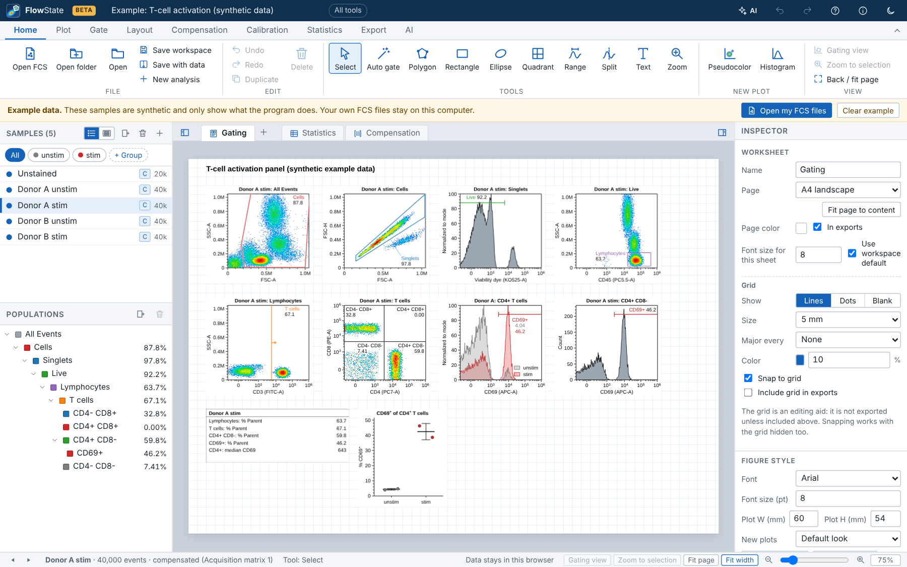
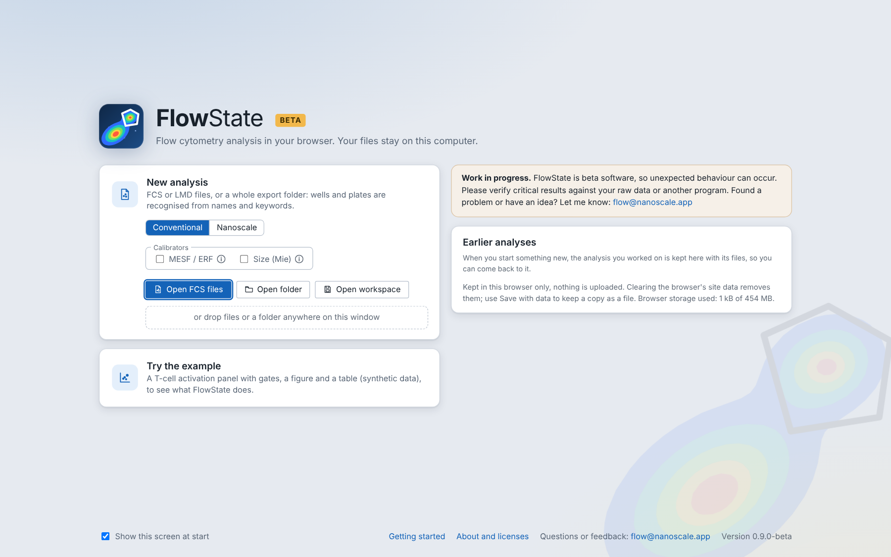
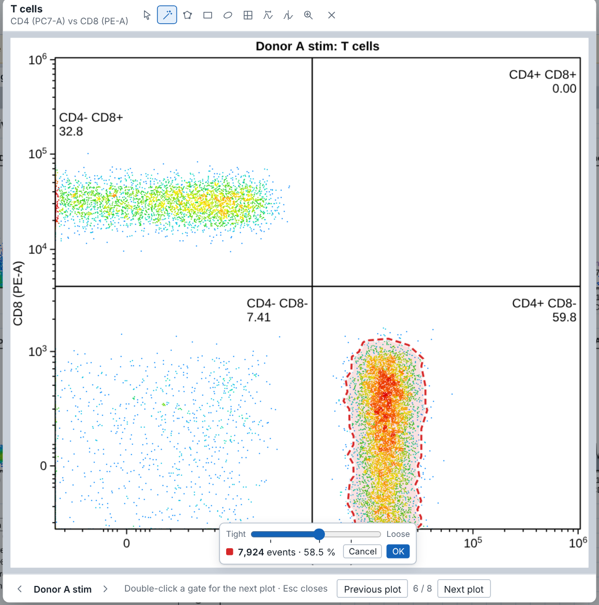
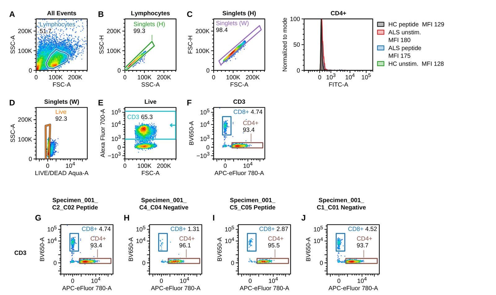
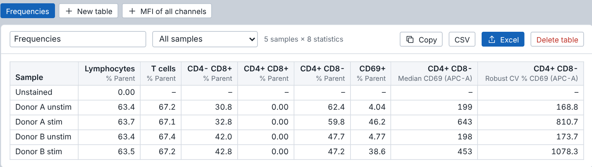
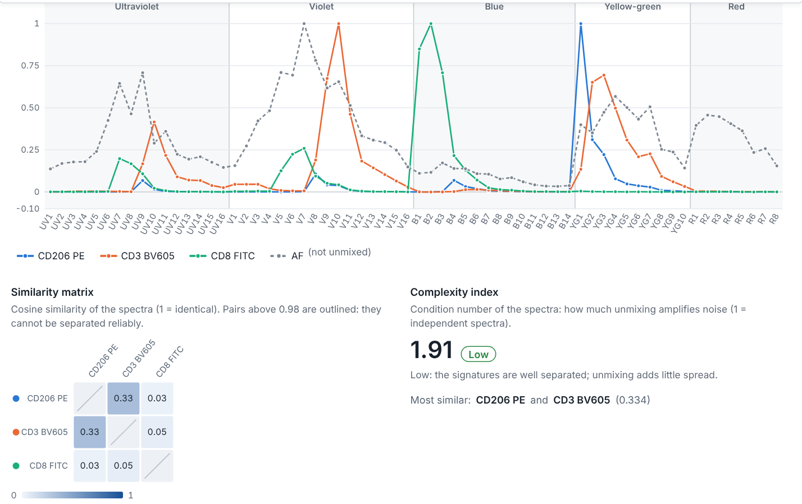
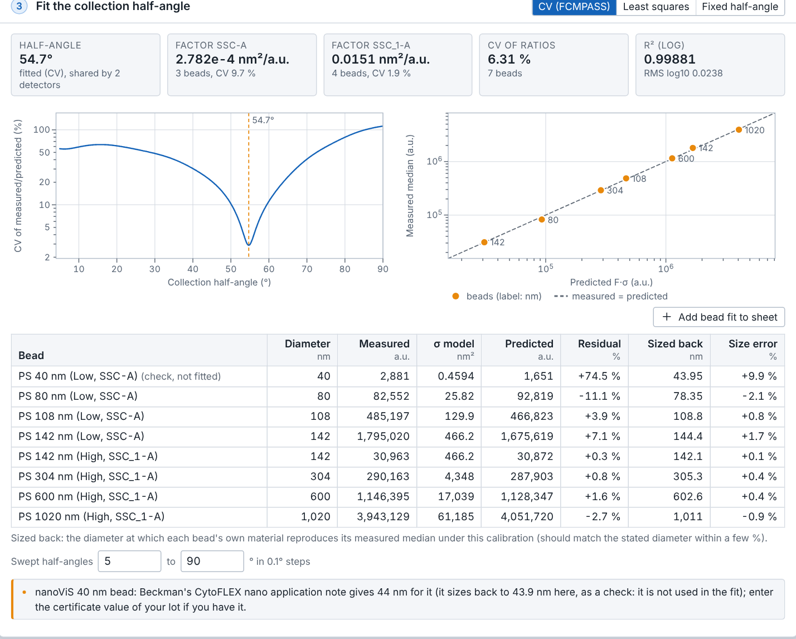
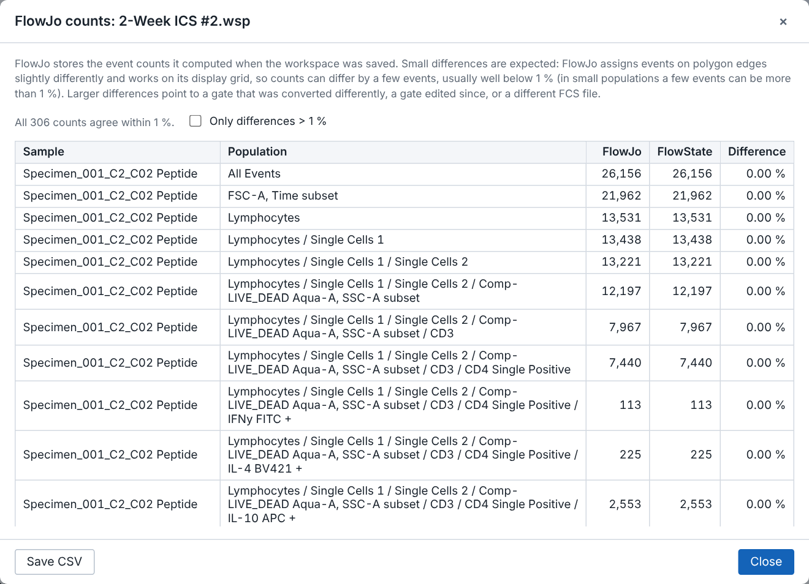

# FlowState

**Flow cytometry analysis and publication-ready figures, right in your browser.**
Gating, statistics, compensation, spectral unmixing, EV size (Mie) and MESF calibration, FlowJo import. No installation
and no upload: your FCS files never leave your computer.

[](LICENSE)




> **Beta, work in progress.** Unexpected behaviour can occur. Please verify critical results against your raw data or
> another program, and let me know if you run into problems or have ideas: [flow@nanoscale.app](mailto:flow@nanoscale.app).
> For research use only, not for diagnostic procedures or clinical decisions.

A one-page overview with screenshots: [docs/FlowState-overview.pdf](docs/FlowState-overview.pdf).

## Get started

1. **Open FlowState.** Download `flowstate-standalone.html` from the [latest release](https://github.com/RueMGross/flowstate/releases/latest) and
   double-click it (Chrome, Edge, Firefox or Safari). Nothing to install; it works offline.
2. **Drop your files.** Drag FCS or LMD files, a whole export folder, a FlowJo `.wsp`, a Gating-ML file or a saved
   FlowState workspace onto the window. Wells and plates are recognised from keywords and names.
3. **Gate, measure, export.** Draw or auto-gate, add statistics, lay out the figure and export PDF, SVG, PNG or TIFF.
   Press `?` for all shortcuts.

On the start screen you choose a conventional or a nanoscale experiment and whether you need MESF and/or size
calibration; tools you do not need stay out of the way (Experiment > Setup changes this later).



## What it does

### Gating: gate quickly, count exactly

- Polygon, rectangle, ellipse, quadrant, range, split and Boolean (AND, OR, NOT) gates
- Auto gate: click a cluster or drag a box, tune it from tight to loose, then OK
- Gate trees per group or per sample, copy gates between groups, adjust a gate for one sample only
- Full undo history, autosave in the browser, workspaces you can reopen anywhere



### Figures ready for the journal

- Lay out panels on a page in millimetres (journal widths 85, 120, 180 mm, A4, 16:9 slides) and export exactly that size
- Repeat a plot for every sample, add panel letters, build a gating-strategy sheet from the gate tree
- PDF with embedded fonts, SVG with editable text, PNG and TIFF up to 1200 dpi
- 20 colormaps (viridis, magma, ...), pseudocolor, contour, density and dot plots, color by a third parameter, backgating



### Statistics tables in seconds

- % of parent, of total or of any ancestor, counts and events/µL
- Median, mean, geometric mean, SD, CV, robust CV, percentiles, mode; MFI of all channels with one button
- Tables update when you move a gate; copy, CSV and Excel; bar and dot charts per sample or group
- Plates: heatmaps of any statistic over 96 and 384 well plates, plate layouts that make groups



### Compensation and spectral unmixing

- Use the cytometer's matrix, fine-tune it with a live preview, or compute it from single stains
- Import CytExpert `.comp`, FlowJo and text matrices; export TXT and CSV
- Spectral unmixing (OLS, WLS, non-negative) with autofluorescence as its own channel, plus similarity, complexity,
  spreading and leakage checks



### Nanoscale: EV sizing and MESF calibration

- Turn side scatter into particle diameter and scattering cross section with Mie theory (spheres and core-shell
  particles, as in FCMPASS), with presets for nanoViS beads on the CytoFLEX nano
- Fit the collection half-angle and size the beads back as a check; valid size range and low-resolution bands shown
- Turn fluorescence into MESF, ERF or ABC units from bead kits; saturated beads are flagged, the calibrated bead range
  is shown and values outside it are marked
- Saturation warnings and a MIFlowCyt-EV style calibration report



### Works with FlowJo, CytExpert, FlowLogic and others

- FlowJo workspaces (`.wsp`) with gates, groups and compensation, with a side-by-side count check
- Gating-ML 2.0 in and out (FlowKit, R/flowCore, Cytobank); populations as FCS 3.1 or CSV
- FCS 2.0 to 3.2 and Beckman LMD; checked on public files from about 25 cytometer models (BD, Beckman Coulter, Cytek,
  Sony, Thermo Fisher, Miltenyi, Agilent and others)



### An optional AI assistant

Off by default. Each action shows exactly what will be sent before anything is sent; event data and files never leave
the browser, and sample and file names can be hidden.

- Analyze new files: the AI reads the files not analyzed yet (and, if you attach it, your protocol as Excel, Word, CSV
  or text: plate layout, conditions, experimental details) and proposes a plan (groups, gates, figures, tables) that
  you tick off and comment on, has it revised if you like, then gates, builds the figures and tables and drafts the
  results. Everything it makes carries a disclaimer, and one Undo removes it all
- How do I …: ask how to do something in your own words; the answer points at the buttons to use (sends only the
  question)
- Describe experiment: reads what you measured and suggests groups, the setup and next steps
- Gate with AI, gating-strategy suggestions, marker labels from your panel
- Drafts of methods text and figure legends, and a check of your analysis for common problems
- Runs on a claude.ai account, your own Anthropic API key, or a lab proxy (`server/ai-proxy/`)

## Your data stay with you

FCS files, workspaces and figures are processed locally in the browser and are never uploaded. The autosave copy is kept
in the browser's storage (IndexedDB). The app loads nothing from other servers: no web fonts, no analytics, no CDN. Only
the optional AI assistant contacts a service, and only when you start an AI action. The About dialog checks this at run
time and names any server the page has contacted in the session.

## Checked against other tools

- FlowJo 10 workspace counts reproduced exactly, including polygons evaluated on FlowJo's gate grid
- FCS values checked against FlowIO, statistics and compensation against FlowKit, Gating-ML against the FlowKit
  compliance suite
- Mie scattering checked against miepython and PyMieScatt; MESF regression against numpy

More in [docs/DETAILS.md](docs/DETAILS.md): plates, the interoperability table, known limits, verification and the
source layout.

## Build from source

```bash
npm ci
npm run dev            # development server
npm test               # tests
npm run build          # static build in dist/
npm run build:single   # one self-contained HTML file (artifact/flowstate-standalone.html, needs Python 3)
```

React 18, TypeScript, Vite and zustand; no server needed. Details in [docs/DETAILS.md](docs/DETAILS.md).

## Contact

Dr. Rüdiger Groß, Institute of Molecular Virology, Ulm University Medical Center, Germany.
Questions, bug reports and ideas: [flow@nanoscale.app](mailto:flow@nanoscale.app) or a GitHub issue.

## How to cite

If FlowState helps your work, please cite it (GitHub: "Cite this repository", from `CITATION.cff`):

> Groß R. FlowState: browser-based flow cytometry analysis. Version 0.10.4-beta. Institute of Molecular Virology, Ulm
> University Medical Center; 2026.

Methods used: Logicle display (Parks, Roederer and Moore 2006; Moore and Parks 2012), Mie scattering of spheres and
coated spheres (Bohren and Huffman 1983), light-scatter calibration after FCMPASS (Welsh et al. 2020).

## License

Copyright (C) 2026 Rüdiger Groß, Institute of Molecular Virology, Ulm University Medical Center.

FlowState is free software: you can redistribute it and/or modify it under the terms of the GNU Affero General Public
License as published by the Free Software Foundation, version 3 only (`AGPL-3.0-only`, full text in [LICENSE](LICENSE)).
It is distributed in the hope that it will be useful, but WITHOUT ANY WARRANTY; without even the implied warranty of
MERCHANTABILITY or FITNESS FOR A PARTICULAR PURPOSE. See the GNU Affero General Public License for more details.

In short: anyone may use, share and change FlowState, also commercially; versions that are shared, or offered to others
as a web service, must stay under the AGPL and come with their complete source code. For other terms, contact the
copyright holder.

Third-party components keep their own licenses (MIT, BSD, Apache-2.0, CC0, Matplotlib and Battelle licenses, SIL OFL
fonts; all compatible with the AGPL); see [THIRD_PARTY_NOTICES.md](THIRD_PARTY_NOTICES.md). The same text is bundled
into the app (About FlowState). Screenshots show the built-in synthetic example or public data sets (FlowJo ICS
workspace, Zenodo 16754553; Cytek Aurora reference controls, Zenodo 17457137; CytoFLEX nano nanoViS files, figshare
31855687).

## Trademarks

FlowState is an independent project and is not affiliated with, endorsed by or sponsored by Beckman Coulter, BD /
FlowJo, LLC, Cytek Biosciences, Thermo Fisher Scientific, Inivai Technologies (FlowLogic), De Novo Software or any other
vendor. CytExpert, CytoFLEX, Kaluza, nanoViS, FlowJo, FACSDiva, SpectroFlo, Attune, FlowLogic, FCS Express and all
other product names are trademarks of their respective owners and are used only to describe file compatibility,
instruments and reagents.
